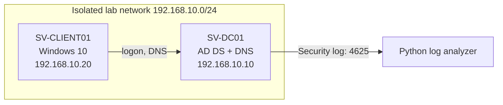

# SV Active Directory Security Lab

A simulated small-company network used to practice centralised user management, account protection and monitoring of suspicious logons.
All names, users and passwords in this repository are **fictional**.

**Author:** Khalid Aslaoui ([@SOOvENSO](https://github.com/SOOvENSO)) · **Brand:** SV

## Status
**Lab design, scripts and a log-analysis tool.** Screenshots and notes from my own build will be added to `docs/` later.
The example output below comes from running the Python analyzer on the included sample data. It is not the result of a live attack.

## Goals
- A central Domain Controller managing users and permissions
- Users organised in Organizational Units (OUs) and groups
- Automation of account creation with PowerShell and a CSV file
- Password and account lockout policies
- Monitoring of failed logons (event ID 4625) and analysis with Python

## Architecture

| Machine | OS | IP | Role |
|---|---|---|---|
| SV-DC01 | Windows Server 2022 | 192.168.10.10 | Domain controller (AD DS + DNS) |
| SV-CLIENT01 | Windows 10 | 192.168.10.20 | Domain-joined workstation |

Domain: `sv.local`. Both machines run as virtual machines on an isolated network (VMware or VirtualBox).



## Active Directory structure
```
sv.local
├── OU=Employees   (s.alami, o.idrissi, h.bennani)
├── OU=IT          (khalidaslaoui)
└── OU=Groups      (IT-Support, Employees-Group)
```
Why OUs: to manage users and permissions centrally, and to apply policies per group of users.

## Password policy

| Policy | Value |
|---|---|
| Minimum password length | 12 characters |
| Password complexity | Enabled |
| Maximum password age | 90 days |
| Account lockout threshold | 5 attempts |
| Lockout duration | 15 minutes |

Goal: reduce the risk of weak passwords and password guessing. Applied with `scripts/password_policy.ps1`.

## Roadmap
Each box is ticked when the step is done and documented with a screenshot in `docs/screenshots/`.

- [ ] SV-DC01 installed, domain `sv.local` created
- [ ] SV-CLIENT01 joined to the domain
- [ ] OUs, groups and users created with PowerShell
- [ ] Password and account lockout policy applied
- [ ] Audit policy for logon events enabled
- [ ] Failed logons generated, exported (event 4625) and analysed with Python

Detailed steps: [`docs/build-steps.md`](docs/build-steps.md).

## Repository layout

| Path | Content |
|---|---|
| `docs/build-steps.md` | Step-by-step guide to build the lab |
| `scripts/create_users.ps1` | Creates OUs, groups, `khalidaslaoui` and employees from a CSV |
| `scripts/users.csv` | Fictional employees |
| `scripts/password_policy.ps1` | Sets the domain password and lockout policy |
| `scripts/audit_policy.ps1` | Enables auditing of logon-related events |
| `scripts/get_failed_logons.ps1` | Exports failed logon events (4625) to CSV |
| `python/analyze_failed_logons.py` | Counts failed logons per source and flags those needing review |
| `python/sample_failed_logons.csv` | Fictional sample data to try the analyzer |
| `python/generate_users.py` | Optional: generates 1,000 fictional users for a scale test |

## Monitoring and analysis
1. On SV-CLIENT01, enter a wrong password several times for a lab user.
2. On SV-DC01, run `scripts/get_failed_logons.ps1` to export events to `failed_logons.csv`.
3. Run `python python/analyze_failed_logons.py failed_logons.csv`.

Example output on the included sample data (`python/sample_failed_logons.csv`):

```
================================
     SECURITY LOG ANALYSIS
================================

IP Address: 192.168.10.20
Failed Attempts: 8
Targeted Accounts: 3
Status: ALERT
Possible Activity: Possible password spraying (one source, several accounts)

IP Address: 192.168.10.21
Failed Attempts: 1
Targeted Accounts: 1
Status: ok

================================
Indicator only, not proof of an attack: review the events manually.
```

A result like this is a first warning, not proof that a password spraying attack happened.

## Security notes
- The lab network is isolated; no real accounts or organisation data are used.
- Passwords are typed at run time and never stored in files.
- ISO files and virtual disks are excluded by `.gitignore`.


## License
MIT, see `LICENSE`.
